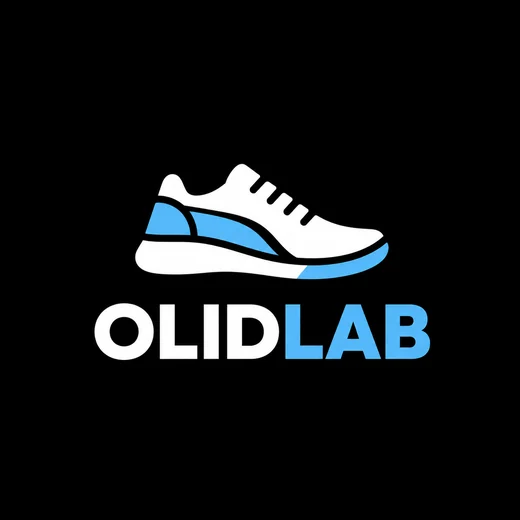

# OLIDLAB 👟
## Step Into Your Style

**A modern footwear storefront concept** featuring curated streetwear sneakers, running shoes, classic dress shoes, boots, sandals and children's footwear.



> **Status: showcase / demonstration.** This is a front-end storefront, not a live shopping business. Product names are genuine, product photos link to third-party sources, and the catalog contains USD retail references or estimates. OLIDLAB has not verified inventory, authorized distribution or customer purchases. There are no real payments, shipping bookings or customer orders.

## ✦ Highlights

- **48 footwear styles and colorways** across Nike, adidas, New Balance, Converse, Vans, ASICS, HOKA, PUMA, Timberland, Dr. Martens, Cole Haan, Clarks, Sam Edelman, Skechers, Steve Madden, Birkenstock and Crocs.
- Six easy-to-browse categories: **Sneakers, Running, Formal, Boots, Sandals and Kids**.
- Gender/audience selectors: men, women, unisex and kids.
- Different externally hosted product photography links for each of the 48 items (internet connection required).
- USD reference prices on every product, with a **RETAIL REFERENCE** or **ESTIMATED REFERENCE** label.
- Click-through source links on all 48 product cards, so visitors can verify current price and availability.
- Interactive search, category tabs, price sorting, filters, quick-view details, shoe size selection, favorites and an editable demonstration shopping bag.
- Browser-local storage for the demo shopping bag and favorites.
- A redesigned premium storefront with new brand rail, editorial lookbook, refreshed product cards and better mobile styling.
- Saved favorites filter to browse liked items easily.
- Displayed **sample US phone +1 (202) 555-0147** (reserved fictional 555-01xx series; it does **not** accept support calls).
- A clean, responsive storefront design with custom OLIDLAB branding.
- No installation, framework, build step or paid hosting required.

## 🚀 Launch locally

**Simplest:** unzip the folder and open `index.html` in your browser. The site does not require a build process. Internet access is required to load externally hosted photos and the optional web font.

**Recommended local server:**

```bash
python -m http.server 8000
```

Then visit `http://localhost:8000`.

## 🌐 Publish on GitHub Pages

1. Create a public repository: `olidlab-shoe-store`.
2. Unzip the project. Upload the **contents** of this folder, including `index.html`, `styles.css`, `app.js`, `products.js`, `store-config.js`, and `assets/`. Do **not** upload only the ZIP if you want GitHub Pages to host the site.
3. On GitHub, open **Settings → Pages**.
4. Under **Build and deployment**, choose **Deploy from a branch**.
5. Select `main` and `/(root)`, then save.
6. GitHub Pages will provide a site link once publishing finishes.

All assets use relative paths so the website works under a repository path.

## 🗂️ Folder layout

```text
olidlab-store/
├── index.html                  # Homepage and UI structure
├── styles.css                  # Responsive styling
├── app.js                      # Filters, quick view, favorites and demo cart
├── products.js                 # Loadable 48-item product catalog
├── products.json               # Editable product catalog source
├── store-config.js             # Business contact configuration
├── README.md                   # This documentation
├── PHOTO-SOURCES.md            # Sources and photo-use notice
└── assets/
    ├── olidlab-logo.webp       # Compressed custom brand image
    └── shoe-fallback.svg       # Used when a remote photo fails to load
```

## 🛍️ Edit a product or price

Products are listed in `products.json` for editing and copied into `products.js` for browsers that open the website locally. After changing the JSON, **update `products.js`** as well. The JavaScript representation begins with `window.OLIDLAB_PRODUCTS =` and ends with `;`.

If you have Python installed, run this from the project directory to sync the files:

```bash
python -c "import json; p=json.load(open('products.json',encoding='utf-8')); open('products.js','w',encoding='utf-8').write('window.OLIDLAB_PRODUCTS = '+json.dumps(p,ensure_ascii=False,indent=2)+';\\n')"
```

Product fields:

| Field | Use |
|---|---|
| `name`, `brand` | Accurate product information |
| `category` | `Sneakers`, `Running`, `Formal`, `Boots`, `Sandals`, or `Kids` |
| `audience` | `Men`, `Women`, `Unisex`, or `Kids` |
| `price` | USD reference value, **not an approved OLIDLAB selling price** |
| `verified` | `true` if observed in the referenced third-party US retail listing; otherwise `false` (estimate) |
| `image` | Externally hosted product picture URL |
| `source` | Page where a visitor can confirm product details and purchase availability |
| `sizes` | Illustrative US size choices. **Not** verified stock |

### Reference pricing

Nine prices were cross-checked with manufacturer/retailer listings during preparation. Others are clearly labeled as **estimates**, not confirmed retailer quotes. All values can change independently of this website. See each model's `source` URL and check real retail price before selling or advertising any item. The storefront never claims the images reflect OLIDLAB's own inventory.

## ☎️ Official support section (demo phone)

Edit `store-config.js`:

```javascript
window.OLIDLAB_CONFIG = {
  name: 'OLIDLAB',
  advisorPhone: '+1 YOUR VERIFIED BUSINESS NUMBER',
  supportEmail: 'your-verified-inbox@yourdomain.com',
  currency: 'USD',
  liveCheckoutEnabled: false
};
```

The store preview has a visible **OLIDLAB OFFICIAL SUPPORT** heading with the *sample* number **+1 (202) 555-0147**. It is a reserved fictional number and does not accept calls. The site labels it as a DEMO CONTACT; replace it with an active, authorized business phone before launching. When `advisorPhone` is empty, the site shows **COMING SOON**.

### How the shopping bag works

The bag is a **non-transactional demo**. It can store styles, selected sizes and quantities in the visitor's browser. The **COPY ITEM INQUIRY** button copies an item list that a user may reference while checking product availability with the retailer. It does not place orders, charge cards, transmit private data or confirm inventory.

To enable actual commerce, integrate a proper inventory database, secure checkout/payment service, authenticated business support channels, transaction email, tax/shipping calculations, and published policies. Changing `liveCheckoutEnabled` alone will **not** provide checkout functionality.

## 🔒 Publishing checklist

- [ ] Verify ownership of the OLIDLAB domain and brand assets.
- [ ] Obtain proper licensing or permission to use any third-party product photographs. **Hotlinking is for prototype demonstration only** and remote hosts may block or remove photos.
- [ ] Replace third-party hotlinked images with approved, locally hosted photography.
- [ ] Confirm relationships with brands/suppliers before claiming authorization.
- [ ] Replace estimated prices with actual OLIDLAB prices and available inventory.
- [ ] Add a real business telephone number, support inbox and actual business location if applicable.
- [ ] Publish real shipping, returns, privacy and terms policies.
- [ ] Add secure payment and order management if you plan to take payments.
- [ ] Test product images and mobile usability after deployment.

## 🎨 Brand direction

- **Name:** OLIDLAB
- **Slogan:** Step Into Your Style
- **Primary palette:** Midnight navy `#101829`, ice blue `#69B8FB`, off-white `#F7F8FA`
- **Language:** English
- **Currency:** USD
- **Style:** Editorial, contemporary, minimalist footwear retail

## ℹ️ Independence and rights

OLIDLAB is an independent storefront concept and is not affiliated with or endorsed by Nike, adidas, Converse, Vans, Timberland or any other referenced brand. Trademarks are the property of their respective holders. Product images hosted by third parties remain their owners' property. These links and images are provided to illustrate products, not as proof that OLIDLAB is authorized to sell them. This repository is not licensed for reuse without further permission.

© 2026 OLIDLAB — Step Into Your Style.

## ⚠️ Demonstration support number

The contact number `+1 (202) 555-0147` was requested as a random example. The `555-0100`–`555-0199` range is reserved for fictional usage in the North American Numbering Plan. This is **NOT** a live customer service number. Update `store-config.js` with a business phone you own before collecting customer inquiries. Do not claim that the example number is available.

## ✨ OLIDLAB V2 notes

- Catalog increased from **28 to 48** individually photographed footwear styles.
- Added Nike, adidas, Converse, Reebok, Crocs, Clarks, Birkenstock, Dr. Martens, UGG, HOKA, On, ASICS and more choices across men's, women's and kids' footwear.
- Added an editorial campaign panel, curated brand strip, refreshed product cards and a *Saved* favorites toggle.
- Shopping bag remains a no-payment **demo**.
- Photos are linked from third-party hosts and may not be licensed for resale marketing; review usage rights and replace them with authorized photos before commercial publishing.
- Refer to `PHOTO-SOURCES.md` for all individual image URLs, sources and reference prices.
